# Assignment 9: Practicing DevSecOps Fundamentals

**Name:** 陳致安 · **Student ID:** B11309058 · **Course:** DevOps · **Date:** November 10, 2026
**Code:** <https://github.com/wagyboy/devops-devsecops-lab>
**Tools:** Flake8 7.4.1 + flake8-bandit 4.1.1 + flake8-bugbear 26.10.27 · GitHub Dependabot · Semgrep 1.183.0 · Hadolint 2.12.0 · Trivy 0.69.3 · OWASP ZAP 2.17.0 · GitHub Actions + Code scanning

| Level | Requirement | What I built | Result (v1 → v2) | Section |
| --- | --- | --- | --- | --- |
| A | Linting for static analysis | Flake8 with the bandit (security) and bugbear (bug) plugins, locally and as a CI gate | 10 findings → 0 | 2 |
| E | Software composition analysis | Dependabot alerts, security updates and version updates for pip, Docker and GitHub Actions | 39 open alerts and 16 PRs → 0 open (39 closed as fixed) | 3 |
| O | Additional DevSecOps practice | **O1:** a 5-gate GitHub Actions pipeline with Semgrep (SAST), Hadolint and Trivy (container) reporting to Code scanning. **O2:** OWASP ZAP DAST against the running app | SAST 8 → 0, fixable image CVEs 279 → 0, ZAP 10 alerts (4 High) → 1 | 4 |

## 1. Introduction: DevSecOps objectives

DevOps shortened the path from commit to production. DevSecOps makes security travel the same path, instead of being a separate review at the end. Its objectives are:

- **Shift left:** find a defect where it is cheapest to fix. A linter warning in the editor costs seconds; the same bug found in production costs an incident.
- **Automate the checks:** every commit and pull request runs the same gates, so security does not depend on someone remembering to look.
- **Cover every layer:** my own code (lint, SAST), the code I import (SCA), the image I ship (container scanning) and the running service (DAST).
- **Make findings actionable:** results go where developers already work (the pull request, the Security tab) with a severity and a fix.

**Method.** I wrote a small Flask shop (product list, search page, purchase API, SQLite, Gunicorn in Docker) and committed it as a first version would plausibly look: string-built SQL, an HTML page assembled with f-strings, a hard-coded secret, `debug=True`, dependencies pinned in late 2022, and a Dockerfile that runs as root. I committed this **v1** together with the pipeline, so every tool had real defects to find. I then fixed what the tools reported in **v2** and ran the same tools again. All numbers in this report come from those runs.

```
 developer ── commit / PR ──► GitHub ──► Actions: lint ─ SAST ─ Dockerfile lint ─ image scan ─► DAST
     ▲                          │                 │       │            │              │           │
     │                          │                 └───────┴── SARIF ───┴──────────────┘           └─► ZAP report (artifact)
     │                          ▼                                  ▼
     └──── fix / merge ◄── Dependabot alerts + PRs        Security tab: Code scanning alerts
```

## 2. (A) Static analysis via linting: Flake8

**Setup.** Flake8 combines pycodestyle (style), pyflakes (unused names, undefined variables) and mccabe (complexity). I added two plugins that move it from style towards defects: **flake8-bandit** (`S` codes, the Bandit security checks) and **flake8-bugbear** (`B` codes, likely bugs).

```bash
python -m venv .venv
.venv/Scripts/pip install flake8==7.4.1 flake8-bandit==4.1.1 flake8-bugbear==26.10.27
.venv/Scripts/flake8 app scripts
```

```ini
# .flake8
[flake8]
max-line-length = 120
exclude = .venv,build,__pycache__
select = E,W,F,C90,S,B      # pycodestyle, pyflakes, complexity, bandit (security), bugbear (bugs)
max-complexity = 10
```

The same pinned versions run in the `lint` job of the pipeline, so local and CI results match.

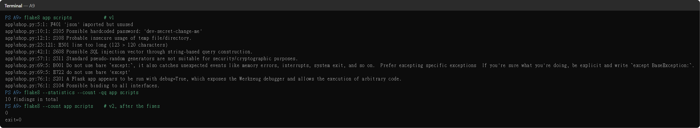

| Code | v1 finding (app/shop.py) | Why it matters | Fix in v2 |
| --- | --- | --- | --- |
| S608 | SQL built by string concatenation (line 42) | SQL injection: `q` becomes part of the query | Bound parameter: `... LIKE ?`, `(f"%{q}%",)` |
| S105 | `SECRET_KEY = "dev-secret-change-me"` | Anyone with the repo can forge session cookies | Read from the environment, random key otherwise |
| S201 | `app.run(debug=True)` | The Werkzeug debugger allows remote code execution | Debug only when `FLASK_DEBUG=1`, local only |
| S104 | `host="0.0.0.0"` | Dev server reachable from the whole network | `127.0.0.1` locally; Gunicorn binds in the container |
| S108 | DB in `/tmp/shop.db` | World-writable directory, file can be replaced | `app.instance_path`, owned by the app user |
| S311 | `random.random()` | Not suitable for security decisions | **False positive**: it only simulates card declines. Kept, with `# noqa: S311` and a comment |
| E722, B001 | bare `except:` | Also swallows `KeyboardInterrupt`, `SystemExit` and real bugs | `except sqlite3.Error:` |
| F401 | `import json` unused | Dead code, hides real dependencies | Removed |
| E501 | 123-character line | Readability; long lines hide logic in review | Wrapped |

**How linting prevents defects.** Linting is the cheapest gate: it runs in under a second, in the editor and in CI, before any build. Four of the ten findings (S608, S105, S201, S104) are real vulnerabilities that a reviewer could miss in a long diff. Linting also enforces a common baseline, so code review can focus on design. Its limit is that each rule sees one line at a time: Flake8 flagged the SQL string but **not** the XSS on the next two lines, because building HTML with an f-string is not a pattern Bandit knows. That gap is why Section 4 adds a SAST tool with data-flow rules.

## 3. (E) Software composition analysis: GitHub Dependabot

**Setup.** Dependabot has three parts. Two are switched on in *Settings → Advanced Security*: **Dependabot alerts** (match the dependency graph against the GitHub Advisory Database) and **Dependabot security updates** (open a PR that upgrades a vulnerable package to the first fixed version). The third, **version updates**, is configured in the repository:

```yaml
# .github/dependabot.yml
version: 2
updates:
  - { package-ecosystem: pip, directory: /app, schedule: { interval: weekly },          # app/requirements.txt
      groups: { flask-stack: { patterns: [Flask, Werkzeug, Jinja2, MarkupSafe, itsdangerous, click] } } }
  - { package-ecosystem: docker, directory: /app, schedule: { interval: weekly } }       # FROM python:... in the Dockerfile
  - { package-ecosystem: github-actions, directory: /, schedule: { interval: weekly } }  # the pipeline's own actions
```

**Results.** Within minutes of the first push, Dependabot reported **39 open alerts** (1 Critical, the rest High to Low) across 9 of the 12 pinned packages, and opened **16 pull requests**.

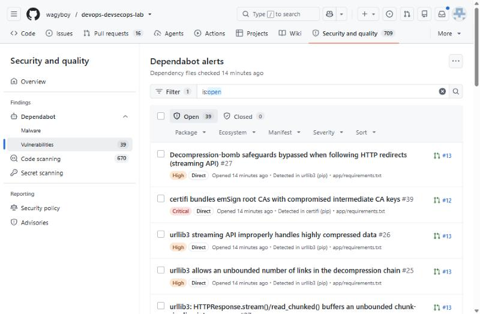 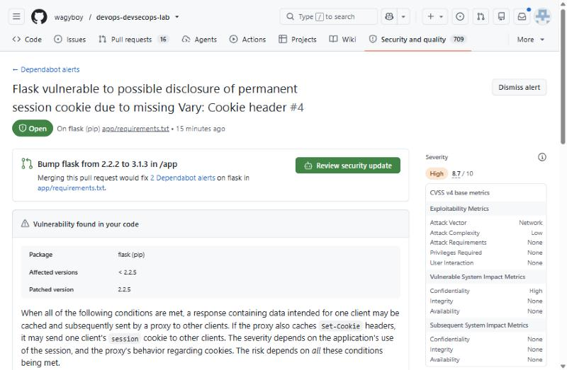

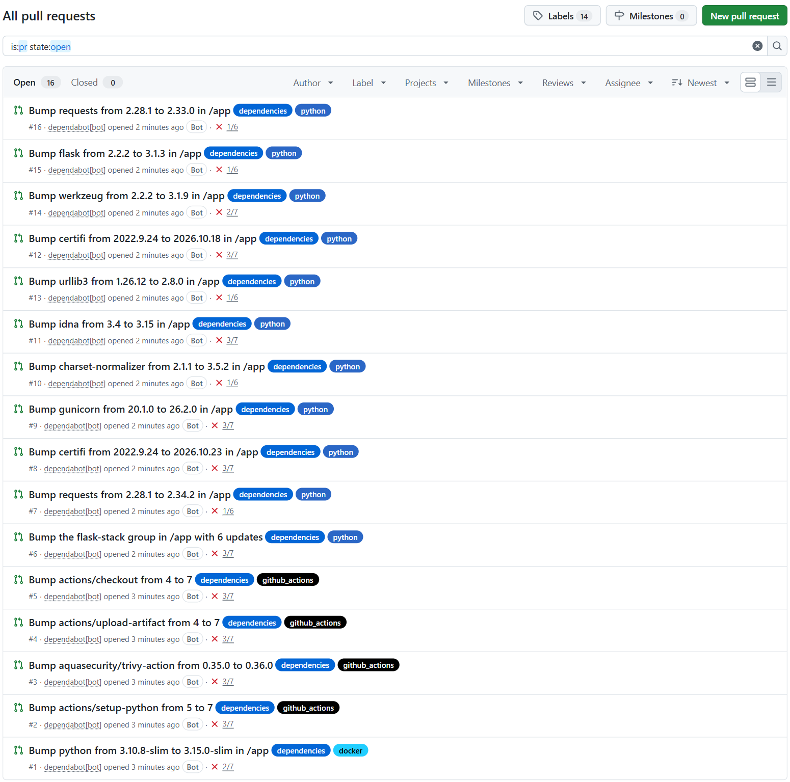 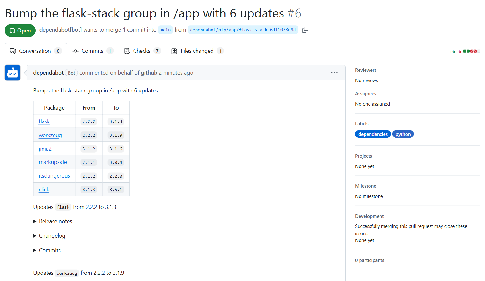

The PR list shows two kinds of pip updates for the same package. **Security updates** go to the *first fixed version* (certifi 2022.9.24 → 2026.10.18, PR #12), the smallest change that closes the alert. **Version updates** go to the *latest version* (certifi → 2026.10.23, PR #8). The `flask-stack` group bundled six packages into one PR (#6), because Flask 3 needs Werkzeug 3 and they cannot be upgraded one at a time.

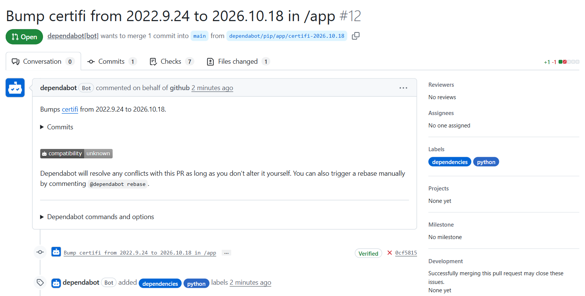 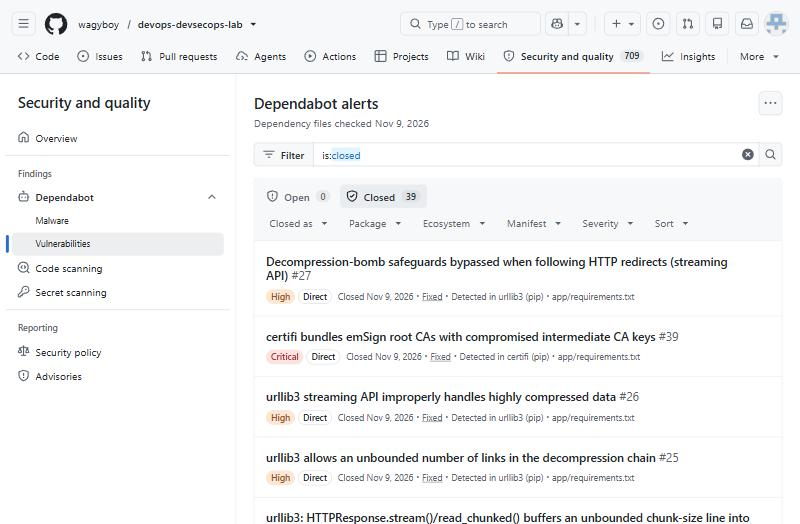

**How SCA contributes to supply chain security.** In this shop I wrote about 100 lines of Python, but the image contains thousands of lines of third-party code that I never read. Most known vulnerabilities come from that code. SCA builds an inventory of every dependency and version (the dependency graph, which is the basis of an SBOM) and watches it against advisory databases, *also after release*: a library that was safe when I pinned it in 2022 now has 39 advisories. It turns "is anything we ship known to be vulnerable?" from an unanswerable question into a list with owners and fixes. Dependabot also covered the supply chain of the pipeline itself, by updating the GitHub Actions I use (Section 4.2 shows why that matters).

**How to interpret CVSS scores and suggested upgrades.**

- **The score is the worst case, not my risk.** CVSS rates a vulnerability from 0 to 10 (Low < 4, Medium 4–6.9, High 7–8.9, Critical ≥ 9). The base metrics in Figure 3 explain the 8.7: reachable over the network (AV:N), low complexity (AC:L), no privileges (PR:N), no user interaction (UI:N), high confidentiality impact (VC:H). But the bug only leaks a session cookie when the app uses *permanent* sessions behind a caching proxy. This shop uses neither, so in my environment the real risk is low. CVSS v4 has *environmental* metrics for exactly this adjustment.
- **Severity sets the order, context sets the urgency.** Reachability (is the vulnerable function used?), exposure (internet-facing or internal?) and exploit availability (is it on CISA's KEV list? what is its EPSS probability?) should be checked before a Critical is treated as an emergency.
- **Suggested upgrades: smallest safe step first.** The security update is a patch or minor jump and rarely breaks anything. A version update can cross a major version (Flask 2 → 3, urllib3 1 → 2, gunicorn 20 → 26), so it needs the changelog and the test suite. Here the CI run on each PR is that test.

**How dependency updates are automated in CI/CD.** The loop that ran in this repository is: Dependabot detects a new advisory or release → opens a PR with the new pin, release notes and a compatibility score → the PR triggers the same pipeline as a human change (lint, SAST, image scan, DAST) → a reviewer merges when it is green. Teams usually add **auto-merge** for patch-level and security updates that pass CI, **groups** to avoid 16 separate PRs, and a **schedule** so updates arrive in one batch per week. In v2 I applied the proposed upgrades together with the code fixes. Dependabot then closed all 39 alerts as *fixed* and closed its 16 PRs as superseded, without anyone triaging them by hand. One proposal I did not follow: PR #1 wanted the newest base image, `python:3.15.0-slim`. I chose `python:3.13-slim` instead, because a brand-new Python release is a bigger change than the upgrade needed to fix the CVEs.

## 4. (O) Advanced DevSecOps practice

### 4.1 O1: A security pipeline with SAST, Dockerfile linting and image scanning

Every push and pull request runs `.github/workflows/devsecops.yml`. Each job is a gate: a finding fails the job, and the run is red.

```yaml
  # simplified excerpt; the full file is .github/workflows/devsecops.yml in the repo
  sast:        # Semgrep: data-flow rules for Python and Flask, plus secret patterns -> SARIF -> Code scanning
    container: { image: semgrep/semgrep:1.183.0 }
    steps:
      - run: semgrep scan --config p/python --config p/flask --config p/secrets --sarif --output semgrep.sarif --error app scripts
      - uses: github/codeql-action/upload-sarif@v4
  dockerfile:  # Hadolint: Dockerfile best practices
    steps: [ run: docker run --rm -i hadolint/hadolint:v2.12.0 hadolint --failure-threshold warning - < app/Dockerfile ]
  image-scan:  # Trivy: OS and Python packages in the built image; SARIF to Code scanning, then a gate step
    steps:
      - uses: aquasecurity/trivy-action@ed142fd0673e97e23eac54620cfb913e5ce36c25  # v0.36.0, pinned by SHA
        with: { image-ref: "a9-shop:${{ github.sha }}", severity: "HIGH,CRITICAL", ignore-unfixed: true, exit-code: "1" }
```

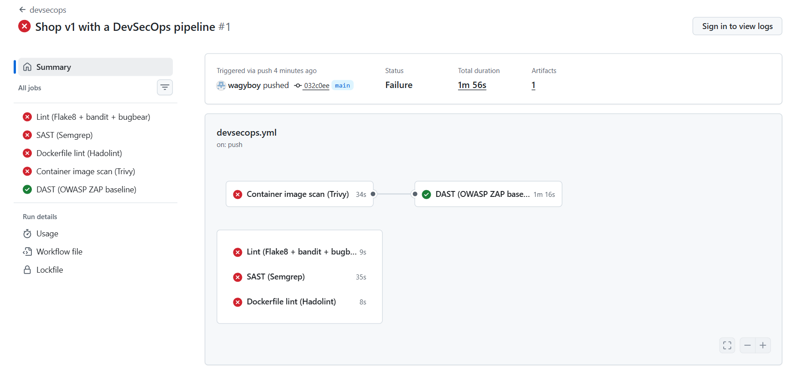 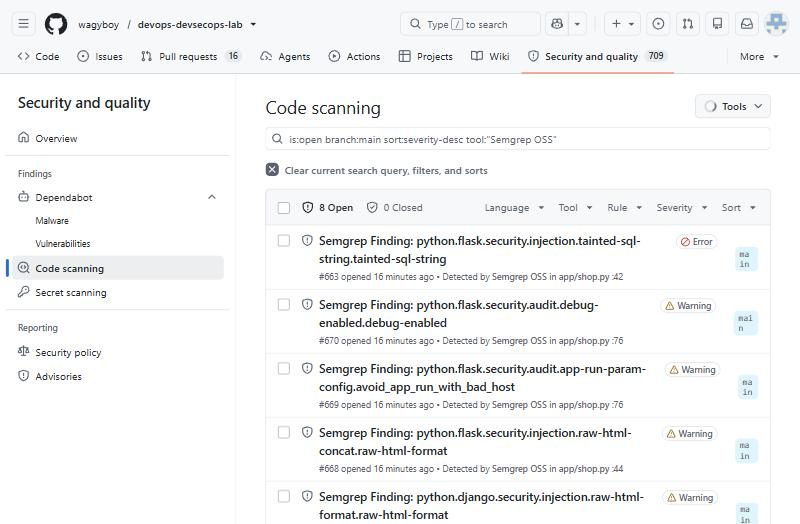

**SAST with Semgrep.** Semgrep found 8 issues in v1, including the two that Flake8 could not see. Its `tainted-sql-string` rule follows the data from `request.args.get("q")` into `conn.execute`, and `raw-html-format` follows it into the returned HTML (reflected XSS). Because the results are uploaded as SARIF, they appear in the repository's Code scanning tab with the exact line, an explanation and a fix.

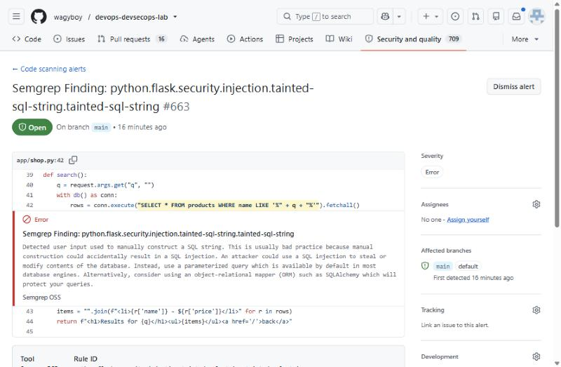 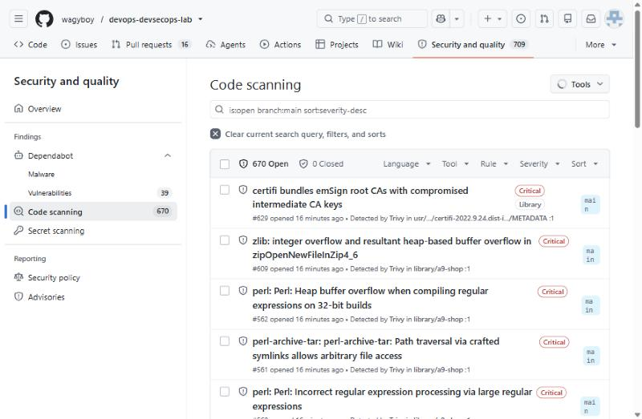

**Container security with Hadolint and Trivy.** The image is what actually runs, so it was scanned on three levels. Hadolint and `trivy config` checked the Dockerfile itself (no `--no-cache-dir`, shell-form `CMD`, **runs as root**, no `HEALTHCHECK`). Trivy then scanned the built image: **662 known vulnerabilities**, 611 in the Debian 11 packages of the old `python:3.10.8-slim` base and 51 in Python packages, 279 of them with a fix available.

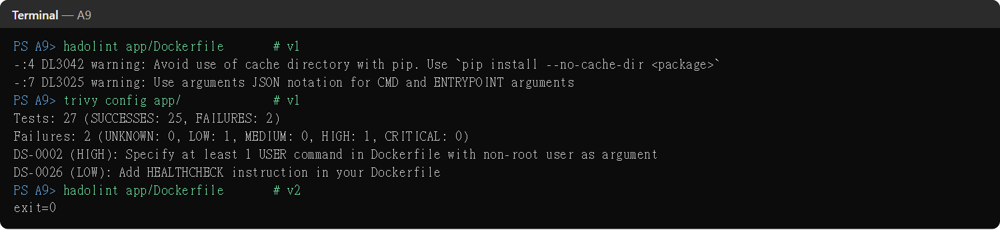 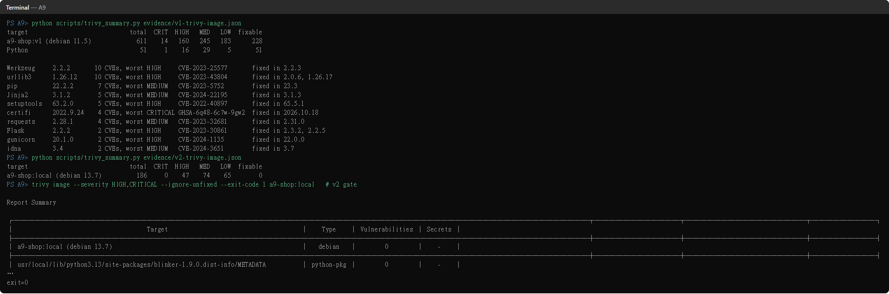

The v2 Dockerfile fixes the image itself, not only the app:

```dockerfile
FROM python:3.13-slim                                   # current Debian 13 base instead of Debian 11.5
RUN apt-get update && apt-get install -y --no-install-recommends --only-upgrade \
      zlib1g=1:1.3.dfsg+really1.3.1-1+deb13u1 && rm -rf /var/lib/apt/lists/*   # fix newer than the base image
RUN pip install --no-cache-dir -r requirements.txt && pip uninstall -y pip setuptools
RUN useradd --create-home --uid 10001 shop && mkdir -p /app/instance && chown shop:shop /app/instance
USER shop                                               # no root at runtime
HEALTHCHECK --interval=30s --timeout=3s CMD ["python", "-c", "import urllib.request; urllib.request.urlopen('http://127.0.0.1:8000/health', timeout=2)"]
CMD ["gunicorn", "--bind", "0.0.0.0:8000", "--workers", "2", "shop:app"]
```

Removing pip from the runtime image was a finding of its own: after the upgrades, Trivy still failed on certifi, urllib3 and msgpack, but these were *pip's own vendored copies*, not mine. The running app never calls pip, so deleting it removed the attack surface instead of only patching it.

**Securing the pipeline itself.** In March 2026, attackers force-pushed 76 of the 77 version tags of `aquasecurity/trivy-action` (CVE-2026-33634), so every workflow that used the action by tag ran a credential stealer before the normal scan. I therefore pinned the action to a full commit SHA. When Dependabot later proposed v0.36.0 (PR #3), I checked before accepting it that the new SHA is the commit of the signed `v0.36.0` tag of an immutable release. A security tool is itself a dependency with access to the pipeline.

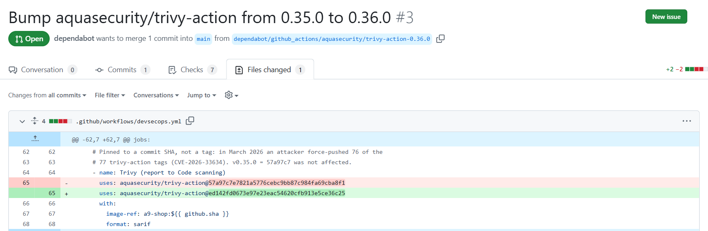

**v2 result.** After the fixes, all five gates pass. In Code scanning, all 8 Semgrep alerts are closed as fixed. Trivy closed 506 of its alerts; the 186 still open are the Debian packages without an upstream fix (Section 5).

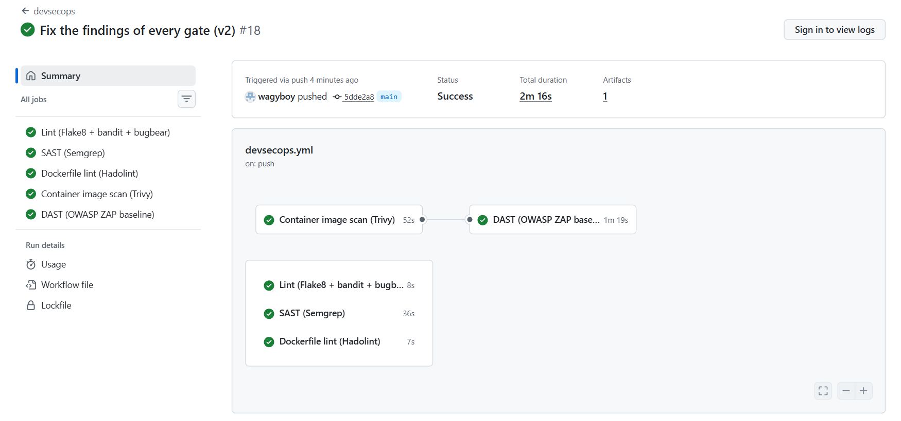 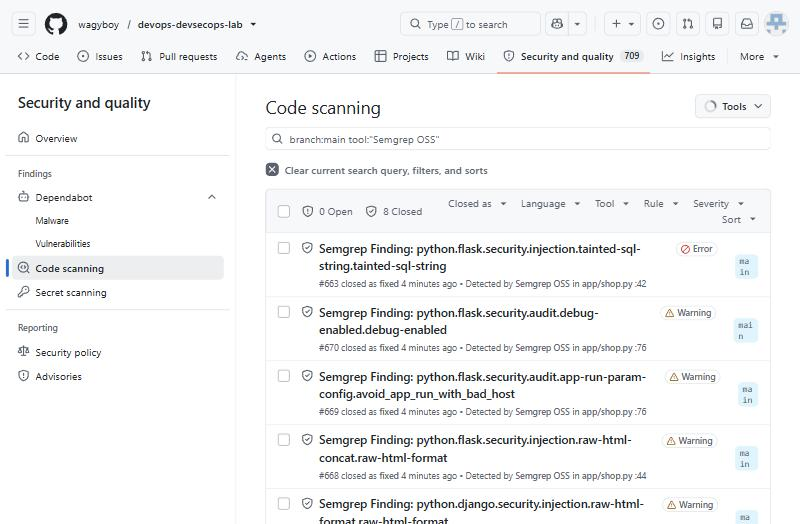

### 4.2 O2: Dynamic testing with OWASP ZAP

Static tools read code. DAST attacks the running application from outside, as an attacker would, without seeing the source. I started the shop with `docker compose up` and ran ZAP's **full scan** (spider + passive rules + active attacks) from a container on the same network:

```bash
docker run --rm --network a9-devsecops_default -v "$PWD/zap:/zap/wrk" zaproxy/zap-stable:2.17.0 \
  zap-full-scan.py -t http://shop:8000 -m 2 -r v1-zap-full.html -J v1-zap-full.json -I
```

The full scan sends attack payloads, so I only ran it against my own local container. The CI `dast` job runs the passive **baseline** scan instead (it does not attack) and keeps the HTML report as a build artifact.

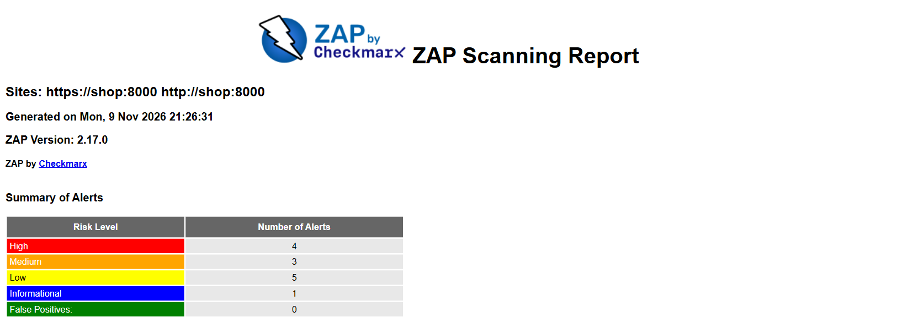 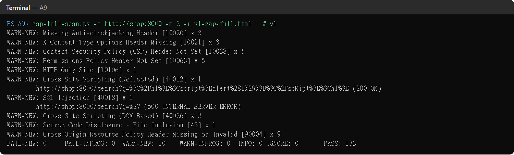

ZAP confirmed with real requests what Semgrep had predicted. `/search?q=</h1><scrIpt>alert(1);</scRipt><h1>` came back executable (reflected XSS), and `/search?q='` produced a 500 error from SQLite (SQL injection). It also found problems that no static tool reported, because they exist only in the HTTP responses: no Content-Security-Policy, no anti-clickjacking header, no `X-Content-Type-Options` and other missing headers.

| Defect in v1 | Flake8 | Semgrep | Trivy | ZAP | Fixed in v2 by |
| --- | --- | --- | --- | --- | --- |
| SQL injection in `/search` | S608 | tainted-sql-string | – | SQL Injection (High) | Bound parameter |
| Reflected XSS in `/search` | – | raw-html-format | – | XSS Reflected (High) | `search.html`, Jinja2 autoescaping |
| Debug server, all interfaces | S201, S104 | debug-enabled, bad host | – | – | Env-controlled, Gunicorn in the container |
| Missing security headers | – | – | – | 5 header alerts | `after_request` adds CSP, nosniff, DENY, ... |
| Vulnerable libraries and OS packages | – | – | 662 | – | Upgrades, new base image, no pip |
| Root container, no health check | – | – | DS-0002, DS-0026 | – | `USER shop`, `HEALTHCHECK` |

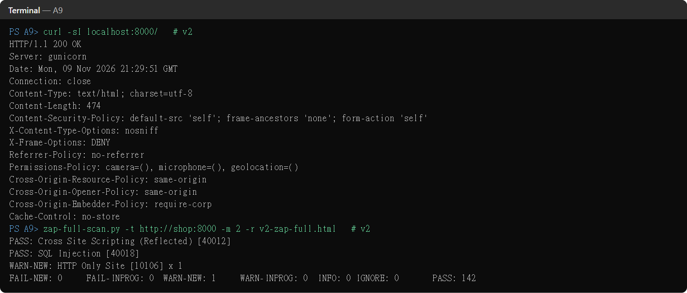

The remaining "HTTP Only Site" alert is expected in this lab: in production, TLS would be terminated by a load balancer or reverse proxy in front of Gunicorn.

### 4.3 How these steps enhance the pipeline's security posture

- **Defense in depth.** No single tool found everything (table above). Linting caught the hard-coded secret, SAST the XSS data flow, SCA and Trivy the third-party code, ZAP the HTTP-level gaps. Each layer covers the blind spot of another.
- **Evidence instead of hope.** Two tools that work in different ways (reading code vs. sending requests) agreed on the two High findings, so they were certainly real. ZAP's PASS results on v2 show the fix works at runtime, not just that the warning disappeared.
- **Gates, not reports.** A red pipeline blocks the merge. v1 could not have reached production unnoticed, and a Dependabot PR that broke the build would also have been stopped.
- **One place to triage.** Semgrep and Trivy results land in the same Code scanning tab as Dependabot alerts, with history and dismiss reasons, instead of in logs nobody reads.
- **The pipeline is protected too.** Actions pinned by SHA, updated by Dependabot and verified before merging, with least-privilege `permissions:` per job.

## 5. Reflections: benefits and limitations

**Benefits.** The whole setup cost a few configuration files, and each gate runs in under 2 minutes. It found SQL injection, XSS, a Critical CA-bundle issue and an RCE-capable debug server on the first push, before any human review. Fixing v1 took one commit. Doing the same after a breach would cost far more.

**Limitations and challenges I met:**

1. **Noise.** Trivy reported 662 vulnerabilities on v1 and still 186 on v2. Most are in Debian packages with no fix available yet. Failing the build on all of them would block every release, so the gate uses `--ignore-unfixed` and HIGH/CRITICAL only. The unfixed ones remain a documented residual risk. A smaller base (distroless or Chainguard) would remove most of them.
2. **False positives need a decision, not silence.** S311 (`random`) and S104 (`0.0.0.0` in the container) are correct by rule but not by context. I kept a justified `# noqa: S311` instead of disabling the rule globally, so the rule still protects the rest of the code.
3. **CVSS is not risk.** The 8.7 Flask alert does not apply to an app without permanent sessions (Section 3). Severity alone over-prioritizes some findings and under-prioritizes others.
4. **Dependabot can flood.** 16 PRs in the first minutes, several overlapping (two certifi PRs, two requests PRs). Groups and a weekly schedule make this manageable. Major-version jumps still need human review.
5. **DAST coverage is limited.** ZAP only tests what it can reach: there is no login here, and the purchase API is a POST endpoint the spider never calls. A real setup would give ZAP an OpenAPI file and test credentials.
6. **Security tools are supply chain too.** The trivy-action incident shows that a scanner with access to the pipeline is a target. Pinning by SHA protects against moved tags, but the pins must be updated and verified, which Dependabot and a manual check now do.

## 6. References

- Flake8: <https://flake8.pycqa.org/> · flake8-bandit: <https://github.com/tylerwince/flake8-bandit> · Bandit rules: <https://bandit.readthedocs.io/>
- GitHub Dependabot: <https://docs.github.com/en/code-security/dependabot> · `dependabot.yml` options: <https://docs.github.com/en/code-security/dependabot/working-with-dependabot/dependabot-options-reference>
- CVSS v4.0 specification (FIRST): <https://www.first.org/cvss/v4.0/specification-document> · EPSS: <https://www.first.org/epss/> · CISA KEV: <https://www.cisa.gov/known-exploited-vulnerabilities-catalog>
- Semgrep: <https://semgrep.dev/docs/> · SARIF upload to Code scanning: <https://docs.github.com/en/code-security/code-scanning/integrating-with-code-scanning/uploading-a-sarif-file-to-github>
- Hadolint: <https://github.com/hadolint/hadolint> · Trivy: <https://trivy.dev/>
- trivy-action supply chain compromise: <https://www.aquasec.com/blog/trivy-supply-chain-attack-what-you-need-to-know/> · GHSA-69fq-xp46-6x23: <https://osv.dev/vulnerability/GHSA-69fq-xp46-6x23>
- OWASP ZAP packaged scans: <https://www.zaproxy.org/docs/docker/full-scan/> · <https://www.zaproxy.org/docs/docker/baseline-scan/>
- OWASP Top 10: <https://owasp.org/Top10/>
